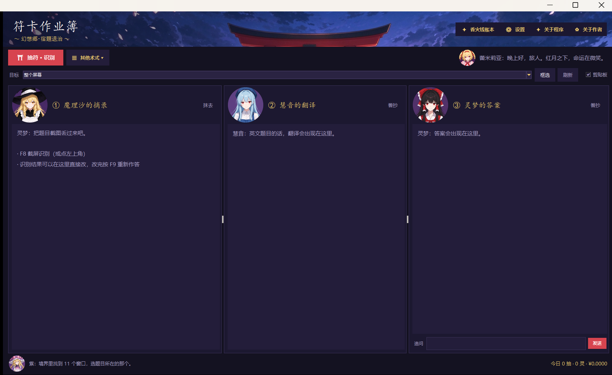
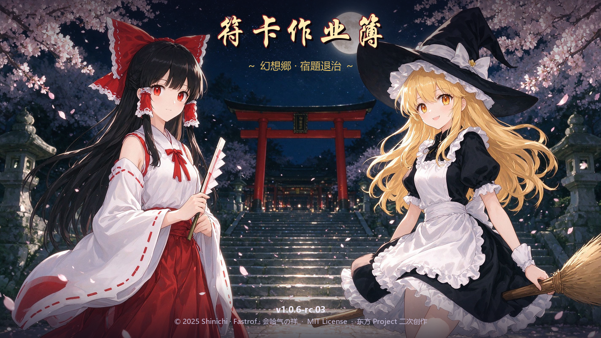
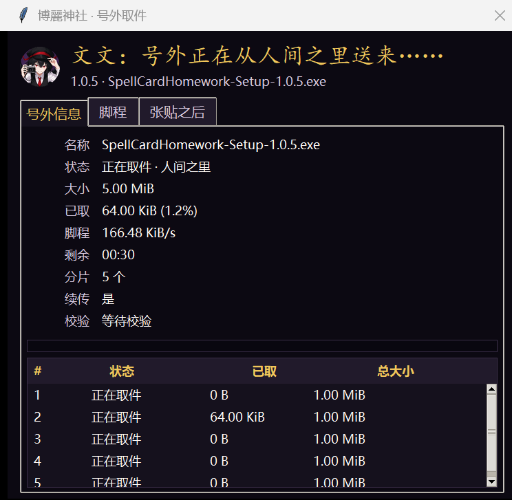
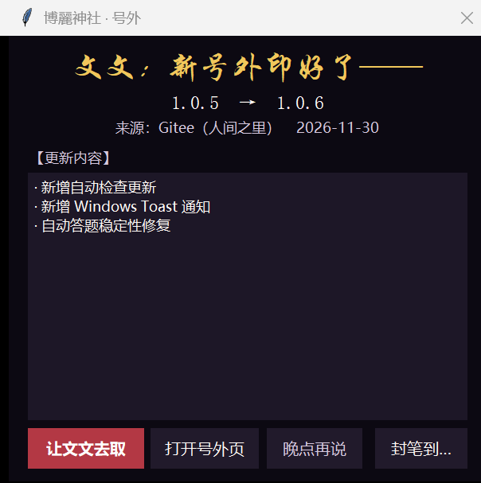
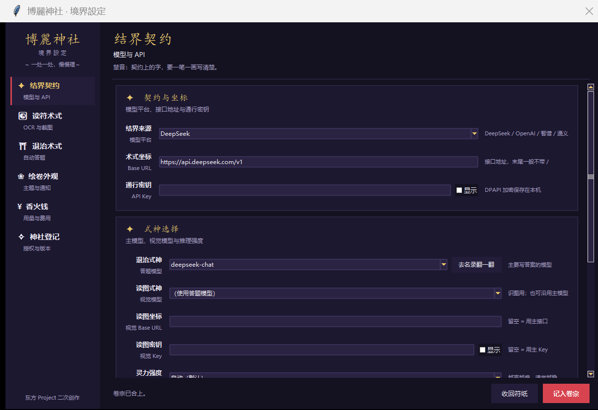

# SpellCardHomework · 符卡作业簿

> ~ Draw · Exterminate · Collect ~

<p align="center">
  <a href="https://github.com/Jerry9335/SpellCardHomework"></a>
  
  
  
  
  
  
  
  <br />
  
</p>

A small Windows desktop tool: **screenshot → OCR → translate → AI answer → fully automatic web answering**.

[中文](./README.md) · [Build guide](./installer/README.md) · [Licensing guide](./docs/author_licensing.md)



## Features

- 🖼 **Screenshot OCR (F8)**: full screen / window / region, Windows OCR or vision model
- 🧮 **Formula rendering**: LaTeX → √, x², ≤, ∑, matrices
- 🌐 **English translation**: English questions are translated to Chinese automatically
- 🤖 **AI answering**: DeepSeek / OpenAI / Zhipu / Qwen / OpenRouter / local Ollama; separate models for answering and vision
- ⚡ **Fully automatic web answering**: drives Edge/Chrome via CDP
  - radio / multi-select / checkbox
  - fill-in-the-blank (fractions, roots, infinity)
  - dropdowns (including Pearson's xlFillinItem)
  - multi-part questions (Part 1 of N)
  - retries with feedback on wrong answers (up to 2)
- 💰 **Usage ledger**: tokens, duration and estimated cost per call, 30-day chart, CSV export
- 🔍 **Balance check**: DeepSeek account balance
- 🔐 **One machine, one code**: Ed25519 signatures, 5-day trial on first launch
- 🌸 **Touhou Project fan-art UI** (AI-generated)
- 📰 **Extra download**: built-in multi-thread downloader with 1–32 threads, resume, SHA256, silent install and restart prompt

## Screenshots

| Splash | Download window |
| --- | --- |
|  |  |

| Update found | Settings |
| --- | --- |
|  |  |

## Requirements

- Windows 10 / 11 (x64)
- Installer build: no Python needed
- From source: Python 3.10+, `Pillow`
- Web automation: Edge or Chrome (Edge recommended)

## Install

### Option 1: Installer (recommended)

Download from [Releases](../../releases):

| File | Description |
| --- | --- |
| `SpellCardHomework-Setup-1.0.6-rc.03.exe` | Standard installer (Inno Setup) |

### Option 2: Run from source

```bash
git clone https://github.com/<your-name>/SpellCardHomework.git
cd SpellCardHomework
pip install pillow
python app.pyw
```

## First launch & licensing

1. On first launch the activation window appears
2. Click **"先试用 5 天"** to start a 5-day trial
3. After the trial you must activate:
   - copy the **machine code** shown in the window
   - **click either email in the window to copy it**, then email that author
   - paste the **activation code** you receive and click activate
4. Codes are bound to the machine; a new PC or a Windows reinstall needs a new code

> Code format: `XXXX-XXXX-XXXX-XXXX-XXXXXXXX-<signature>`, about 130 characters — paste the whole string.

## Settings glossary (Touhou terms → real meaning)

| In the UI | Meaning |
| --- | --- |
| 结界来源 | Model provider |
| 术式坐标 | Base URL |
| 通行密钥 | API Key (DPAPI-encrypted locally) |
| 退治式神 | Answering model |
| 读图式神 / 读图坐标 / 读图密钥 | Vision model / endpoint / key |
| 灵力强度 | Reasoning effort |
| 读符方式 | OCR mode (auto / vision / local) |
| 附加咒文 | Extra JSON body |
| 香火钱 | API balance |
| 抽符方式 | Capture method |
| 结界遮蔽 | Hide this window while capturing |
| 自动监视 | Auto-watch interval / settle / threshold |
| 剪贴符纸 | Clipboard OCR (Win+Shift+S) |
| 结界范围 | Auto-watch browser foreground only |
| 结界入口 | DevTools port / launcher |
| 入口坐标 | URL opened by "open browser" |
| 神社登记 | License status and machine code |

## Usage ledger

- Every API call records: model, prompt/completion tokens, duration, estimated cost
- Stored in `%APPDATA%\SpellCardHomework\usage.jsonl`
- The ledger shows today/total, a 30-day chart, per-model usage and recent calls
- CSV export supported
- Costs are **estimates**; prices live in `PRICES` in `modules/usage.py`

## Build from source

```bat
:: 1. Bundle the app (icon + version info)
python -m PyInstaller --noconfirm --clean --windowed --name "SpellCardHomework" ^
  --icon "assets/icon.ico" --version-file "installer/version_info.txt" ^
  --add-data "assets;assets" --add-data "tools/ocr_ps.ps1;tools" ^
  --add-data "启动答题浏览器.bat;." app.pyw

:: 2. Installer (Inno Setup 7)
"D:\Program Files\Inno Setup 7\ISCC.exe" installer\SpellCardHomework.iss

:: 3. MSIX (optional, local build only, not published with releases)
powershell -ExecutionPolicy Bypass -File installer\build_msix.ps1
```

## Project layout

```
app.pyw                main GUI and pipelines
modules/               capture, OCR, LLM, CDP web, licensing, usage, prompts
assets/                UI images, character art, icons
tools/                 dev and test scripts
installer/             Inno Setup script, MSIX manifest, version info
docs/                  screenshots and docs
```

## Changelog

### v1.0.6-rc.03 (2026-11-24)

- **First-run contract**: after activation, a 3-step wizard for provider, API key (test/skip), and primary/vision models
- **Six-step onboarding**: Kaguya, Eirin, Reisen, Tewi and Kagerou introduce the main UI, capture, barrier, full-auto, ledger and settings
- **No re-prompt for existing users**: onboarding state distinguishes first installs from upgrades; reopen any time from Settings
- **Version marker**: app, installer, splash and docs now read v1.0.6-rc.03

### v1.0.6 (2026-11-23)

- **Safer full auto**: field-level UID/signature snapshots, Dojo player state, unique Check, banked skips and precise "leave unchecked" warnings
- **Multi-candidate solving**: 3 independent samples, voting, escalation, cross-review, local substitution checks and R1 re-check
- **Choice matching**: `B`, `B. 90%`, `Option B: ...` and exact labels; ambiguous or duplicate options are rejected instead of guessed
- **Feedback state machine**: Good job / Incorrect / Partially correct, popup-scoped OK/Next and stale-dialog cleanup
- **Formula palette and matrices**: More page support, matrix/vector/piecewise insertion with verification
- **Manual start**: no auto-start on launch; barrier and auto-answer toasts
- **Fixes**: Incorrect counted as correct, skipped questions pulled back, false "session finished" after manual stop, submitting with too few blanks, `CHOICE B` parsing, prerelease version comparison, trial reset loophole, ledger font crash, minimised-window monitor shutdown
- **Authors**: added 会哈气の祥; three developers in a vertical layout; all version strings and the splash updated to v1.0.6

### v1.0.5 (2026-11-22)

- **True translucent UI**: full-window artwork with semi-transparent panels; no large black title plate
- **Extra download**: multi-thread installer download with 1–32 threads, pause/resume and resume support
- **SHA256 verification**; auto-install is disabled if the checksum is missing or wrong
- **Silent overwrite install** with a restart prompt
- **Download-complete window** with drag-to-folder support and a directory picker fallback
- **Version bump**: app, installer, splash and file metadata are now v1.0.5

### v1.0.1 (2026-11-20)

- **Licensing upgraded** to Ed25519 asymmetric signatures; only the public key ships, so publishing the source cannot forge codes
- **First launch** shows the activation window first, with "start 5-day trial" or an activation code
- **Boot log**: every launch writes `access=licensed/trial/fresh/expired` to `%APPDATA%\SpellCardHomework\boot.log`
- **Second check**: access is re-verified right before the main window is shown
- **Uninstall cleanup**: removes `license.json`, `trial.json`, the local trial backup and the registry entry (settings and API key are kept)
- **Installer**: adds the End User License Agreement page and an optional "clear local license" task
- **UI fixes**: settings window is scrollable with a fixed footer; About / Authors dialogs size themselves to their content
- **Identity**: the installed exe now has the "符卡作业簿" file description and the Reimu icon; splash version is v1.0.1

### v1.0.0

- First release: screenshot OCR, translation, AI answering, fully automatic web answering, usage ledger, balance check, one-machine-one-code licensing

## FAQ

**Q: Why does a reinstall still show as activated?**
Since v1.0.1 the uninstaller removes license records. Older uninstallers did not, so delete them manually:

```powershell
Remove-Item "$env:APPDATA\SpellCardHomework\license.json","$env:APPDATA\SpellCardHomework\trial.json" -Force -ErrorAction SilentlyContinue
Remove-Item "$env:LOCALAPPDATA\SpellCardHomework\.spellcard_trial" -Force -ErrorAction SilentlyContinue
Remove-ItemProperty "HKCU:\Software\Shinichi\SpellCardHomework" -Name trial -ErrorAction SilentlyContinue
```

**Q: The first launch went straight to the main window.**
Check that About shows **v1.0.6-rc.03**, then look at the `access=` lines in `%APPDATA%\SpellCardHomework\boot.log`.

**Q: The activation code is very long.**
v1.0.6-rc.03 codes are about 130 characters — paste the whole string.

## License and assets

- **Code**: MIT, see [LICENSE](./LICENSE)
- **Images**: not covered by MIT
  - Character art, splash, banner and icon are **AI-generated Touhou Project fan works**
  - Touhou Project characters © ZUN / Team Shanghai Alice
  - This is a **non-commercial fan project**, not affiliated with the official team
  - Do not use the art commercially; credit the source when sharing

## Disclaimer

For learning and personal use only. Users are responsible for complying with their school's rules, platform terms of service and local laws. The authors are not liable for any consequences of using this tool.

## Contact

- **Shinichi** — core app / OCR / automation · 1651452812@qq.com
- **Fastrof** — UI art / testing / assets · 3530209532@qq.com
- **会哈气の祥** — formula palette / matrix input / bug fixes · https://github.com/lic402514-gif

## Star History

> **退治辛苦了！往赛钱箱里投一枚 ⭐，灵梦下次退治会更快。**
>
> [Put a ⭐ into the donation box on GitHub](https://github.com/Jerry9335/SpellCardHomework/stargazers)

<a href="https://www.star-history.com/?repos=jerry9335%2Fspellcardhomework&type=date&legend=top-left">
 <picture>
   <source media="(prefers-color-scheme: dark)" srcset="https://api.star-history.com/chart?repos=jerry9335/spellcardhomework&type=date&theme=dark&legend=top-left" />
   <source media="(prefers-color-scheme: light)" srcset="https://api.star-history.com/chart?repos=jerry9335/spellcardhomework&type=date&legend=top-left" />
   
 </picture>
</a>
