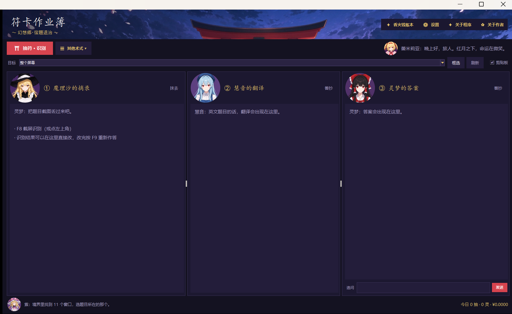
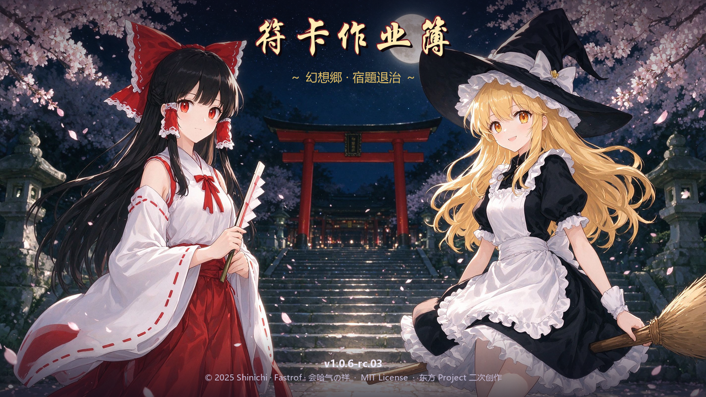
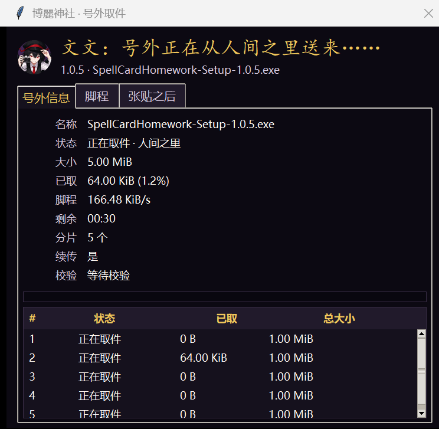
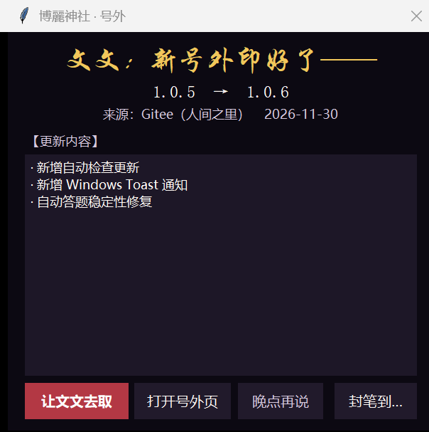
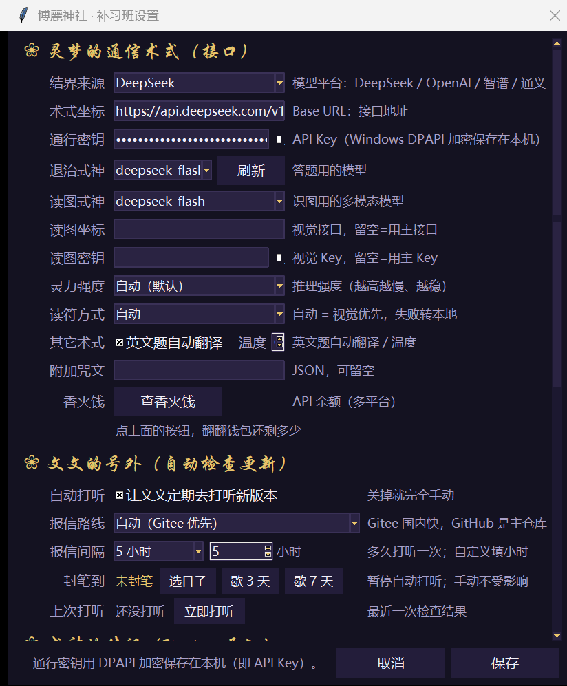

# 符卡作业簿 · SpellCardHomework

> ～ 抽符 · 退治 · 收卡 ～

<p align="center">
  <a href="https://github.com/Jerry9335/SpellCardHomework"></a>
  
  
  
  
  
  
  
  <br />
  
</p>

Windows 桌面小工具：**截屏识题 → 英文翻译 → AI 作答 → 全自动网页答题**。

[English](./README.en.md) · [打包说明](./installer/README.md) · [发码流程](./docs/author_licensing.md)



## 功能

- 🖼 **截屏识别（F8）**：全屏 / 窗口 / 框选，本地 Windows OCR 或视觉模型读题
- 🧮 **公式渲染**：LaTeX 自动转成 √、x²、≤、∑、矩阵等可读符号
- 🌐 **英文题翻译**：识别到英文题目自动翻译成中文
- 🤖 **AI 作答**：DeepSeek / OpenAI / 智谱 / 通义 / OpenRouter / 本地 Ollama 等兼容接口；答题模型与视觉模型可分开配置
- ⚡ **全自动网页答题**：通过 CDP 接管 Edge / Chrome，自动读题、填答案、交卷、翻页
  - 单选 / 多选 / 复选框
  - 填空（分数、根号、无穷等符号）
  - 下拉框（含 Pearson 的 xlFillinItem）
  - 多小问（Part 1 of N）逐问作答
  - 答错带提示重算，最多重试 2 次
- 💰 **香火钱账本**：每次调用的 tokens、耗时、费用估算，30 天柱状图，可导出 CSV
- 🔍 **查余额**：DeepSeek 账户余额查询
- 🔐 **一机一码**：Ed25519 签名，首次启动可试用 5 天
- 🌸 **东方 Project 风格界面**（AI 生成的二次创作立绘）
- 📰 **号外取件**：内置多线程下载器，支持 1–32 线程、断点续传、SHA256 校验、自动覆盖安装与重启提示

## 截图

| 启动画面 | 下载窗口 |
| --- | --- |
|  |  |

| 发现新版本 | 设置 |
| --- | --- |
|  |  |

## 系统要求

- Windows 10 / 11（x64）
- 使用安装包：无需安装 Python
- 源码运行：Python 3.10+，依赖 `Pillow`
- 全自动答题：Edge 或 Chrome（推荐 Edge）

## 安装

### 方式一：安装包（推荐）

从 [Releases](../../releases) 下载：

| 文件 | 说明 |
| --- | --- |
| `SpellCardHomework-Setup-1.0.5.exe` | 常规安装包（Inno Setup） |

### 方式二：源码运行

```bash
git clone https://github.com/<your-name>/SpellCardHomework.git
cd SpellCardHomework
pip install pillow
python app.pyw
```

## 首次启动与授权

1. 首次启动会弹出「博麗神社 · 结界许可」
2. 可以点 **「先试用 5 天」** 直接试用
3. 试用到期后必须激活：
   - 复制窗口里的 **本机灵符**（机器码）
   - **点一下窗口里的邮箱即可复制**，发邮件给作者任一位
   - 收到 **许可咒文**（激活码）后粘贴，点「解开结界」
4. 激活码绑定机器码，换电脑或重装系统后需要重新申请

> 激活码格式：`XXXX-XXXX-XXXX-XXXX-XXXXXXXX-<签名>`，约 130 字符，整段复制粘贴即可。

## 设置项说明（东方话术对照）

| 界面上的词 | 实际含义 |
| --- | --- |
| 结界来源 | 模型平台（DeepSeek / OpenAI / 智谱 / 通义…） |
| 术式坐标 | Base URL（接口地址） |
| 通行密钥 | API Key（DPAPI 加密保存在本机） |
| 退治式神 | 答题用的模型 |
| 读图式神 / 读图坐标 / 读图密钥 | 识图用的视觉模型 / 接口 / Key |
| 灵力强度 | 推理强度（越高越慢、越稳） |
| 读符方式 | OCR 方式（自动 / 视觉 / 本地） |
| 附加咒文 | JSON 自定义参数 |
| 香火钱 | API 余额查询 |
| 抽符方式 | 屏幕抓取方式 |
| 结界遮蔽 | 截图时本窗口自动让位 |
| 自动监视 | 自动监听间隔 / 静置 / 阈值 |
| 剪贴符纸 | 剪贴板自动识别（Win+Shift+S） |
| 结界范围 | 自动监听只扫浏览器前台 |
| 结界入口 | 网页调试端口 / 启动答题浏览器 |
| 入口坐标 | 点「张开结界」时打开的网址 |
| 神社登记 | 授权状态与机器码 |

## 香火钱账本

- 每次调用自动记录：模型、输入/输出 tokens、耗时、估算费用
- 数据保存在 `%APPDATA%\SpellCardHomework\usage.jsonl`
- 账本界面可看今日/累计、30 天柱状图、每个模型的消耗、最近调用明细
- 支持导出 CSV
- 费用为**估算值**，单价表在 `modules/usage.py` 的 `PRICES`，实际以平台账单为准

## 从源码构建

```bat
:: 1. 打包独立程序（含版本信息与图标）
python -m PyInstaller --noconfirm --clean --windowed --name "SpellCardHomework" ^
  --icon "assets/icon.ico" --version-file "installer/version_info.txt" ^
  --add-data "assets;assets" --add-data "tools/ocr_ps.ps1;tools" ^
  --add-data "启动答题浏览器.bat;." app.pyw

:: 2. exe 安装包（Inno Setup 7）
"D:\Program Files\Inno Setup 7\ISCC.exe" installer\SpellCardHomework.iss

:: 3. MSIX（可选，本地构建，不随 Release 发布）
powershell -ExecutionPolicy Bypass -File installer\build_msix.ps1
```

## 目录结构

```
app.pyw                主程序（Tkinter 界面 + 各条流水线）
modules/               截图、OCR、AI、网页 CDP、授权、用量、提示词
assets/                界面图片、角色立绘、图标
tools/                 开发与测试脚本
installer/             Inno Setup 脚本、MSIX 清单、版本信息
docs/                  截图与文档
```

## 更新日志

### v1.0.6-beta2（2026-11-23）

- 修复全自动模式的死循环：跳过题/部分正确题不再被“回补未完成题”反复拉回
- 修复点「收工」后仍弹「这一轮退治完了」的假通报
- 修正题号列表统计：`Incorrect` 不再被当成 `Correct`
- 修复清空试用记录后可无限重领 5 天试用
- 填空数量不足时判失败，不再带着空格去 Check
- 答案解析容忍 `CHOICE B`、`**CHOICE**: A` 等写法，不再整题跳过
- 版本比较支持预发布后缀，beta 用户能收到同号正式版的更新提示
- 公式调色板：自动展开 More / 回第一页、按输入框定位、矩阵弹窗 id 兜底
- 状态栏不再被随机台词覆盖；账本柱状图缺字体不再崩；窗口最小化不再关掉自动监视
- 新增回归测试 `tools/test_bugfixes_v106.py`

### v1.0.5（2026-11-22）

- **真半透明界面**：全窗口背景图 + 半透明面板，标题不再使用大面积黑色遮罩
- **号外取件**：多线程下载安装包，支持 1–32 线程、暂停/继续、断点续传
- **SHA256 校验**：下载后自动校验；不匹配或缺失时不自动安装
- **自动覆盖安装**：校验通过后静默安装，并提示现在重开或稍后自己开
- **下载完成窗口**：支持把安装包拖到桌面 / 文件夹，另有选择目录兜底
- **版本更新**：程序、安装包、启动图、文件版本统一为 v1.0.5

### v1.0.1（2026-11-20）

- **授权升级**：激活码改为 Ed25519 非对称签名，程序里只放公钥，源码公开也无法伪造
- **首次启动**：先弹「博麗神社 · 结界许可」，可选「先试用 5 天」或输入激活码
- **启动日志**：每次启动把 `access=licensed/trial/fresh/expired` 写进 `%APPDATA%\SpellCardHomework\boot.log`
- **双保险**：显示主界面前再校验一次授权，没有许可/试用直接退出
- **卸载清理**：卸载时清除 `license.json`、`trial.json`、本地试用备份和注册表记录（保留设置与 API Key）
- **安装包**：新增《最终用户许可协议》页；新增可选任务「清除本机授权与试用记录」
- **界面修复**：设置窗口可滚动、底部按钮固定；关于程序 / 关于作者按内容自适应大小
- **窗口规范化**：安装版 exe 带有「符卡作业簿」文件描述和灵梦图标；启动图版本号同步为 v1.0.1

### v1.0.0

- 首个版本：截屏识别、英文翻译、AI 作答、全自动网页答题、香火钱账本、余额查询、一机一码授权

## 常见问题

**Q：重装后为什么还是已激活？**
v1.0.1 起卸载会自动清除授权记录。如果旧版本卸载过，旧卸载程序不会清授权，需要手动删除：

```powershell
Remove-Item "$env:APPDATA\SpellCardHomework\license.json","$env:APPDATA\SpellCardHomework\trial.json" -Force -ErrorAction SilentlyContinue
Remove-Item "$env:LOCALAPPDATA\SpellCardHomework\.spellcard_trial" -Force -ErrorAction SilentlyContinue
Remove-ItemProperty "HKCU:\Software\Shinichi\SpellCardHomework" -Name trial -ErrorAction SilentlyContinue
```

**Q：首次启动直接进了主界面？**
先确认「关于程序」里版本是 **v1.0.5**，再看 `%APPDATA%\SpellCardHomework\boot.log` 里的 `access=` 记录。

**Q：激活码太长？**
v1.0.5 的激活码约 130 字符，整段复制粘贴即可。

## 开源协议与素材说明

- **代码**：MIT，详见 [LICENSE](./LICENSE)
- **图片素材**：不在 MIT 授权范围内
  - 角色立绘、启动图、横幅、图标为 **AI 生成的东方 Project 二次创作**
  - 东方 Project 角色版权归 **ZUN / 上海爱丽丝幻乐团** 所有
  - 本项目为**非商业同人作品**，与官方无关
  - 请勿将素材用于商业用途；转载/二次使用请注明出处

## 免责声明

本项目仅供学习与个人使用。使用者需自行遵守所在学校、考试平台及当地法律法规的要求；因使用本工具产生的任何后果由使用者自行承担。

## 联系

- **Shinichi**（主开发）— 程序主体 / 截屏识别 / 全自动化 · 1651452812@qq.com
- **Fastrof**（副开发）— 界面美术 / 测试 / 素材整理 · 3530209532@qq.com

## Star History

> **退治辛苦了！往赛钱箱里投一枚 ⭐，灵梦下次退治会更快。**
>
> [去 GitHub 往赛钱箱投一枚 ⭐](https://github.com/Jerry9335/SpellCardHomework/stargazers)

<a href="https://www.star-history.com/?repos=jerry9335%2Fspellcardhomework&type=date&legend=top-left">
 <picture>
   <source media="(prefers-color-scheme: dark)" srcset="https://api.star-history.com/chart?repos=jerry9335/spellcardhomework&type=date&theme=dark&legend=top-left" />
   <source media="(prefers-color-scheme: light)" srcset="https://api.star-history.com/chart?repos=jerry9335/spellcardhomework&type=date&legend=top-left" />
   
 </picture>
</a>
